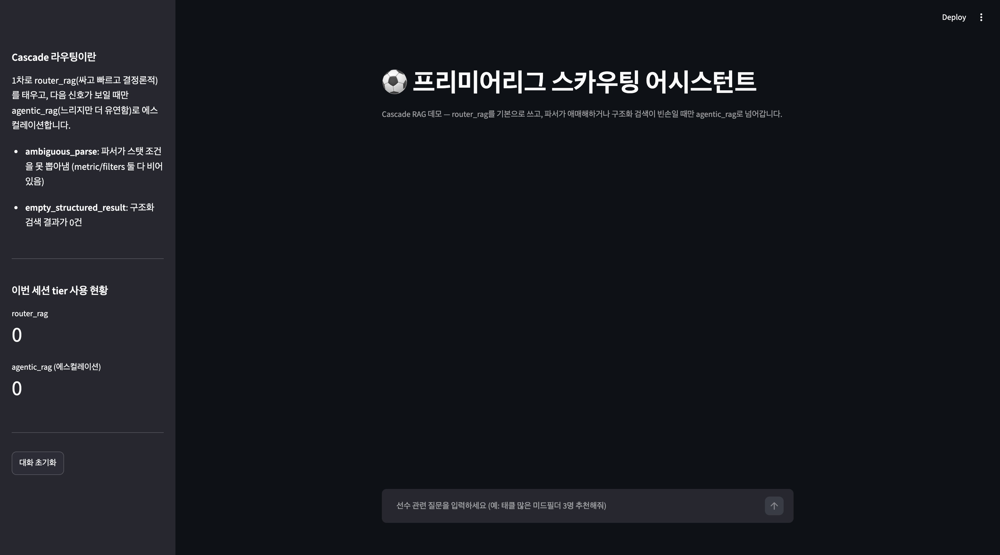
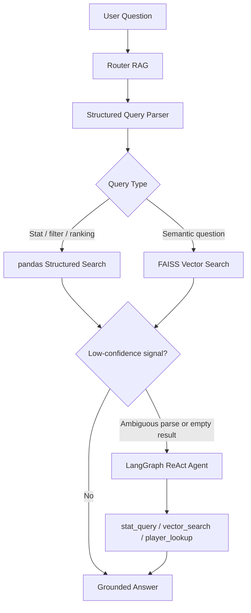

<div align="center">

# ⚽ Footballer Scouting Agent

### 벡터 검색의 한계를 측정하고, 구조화 검색과 AI Agent로 해결한 RAG 비교 프로젝트


</div>

프리미어리그 2024-25 선수 스탯을 자연어로 질의하는 스카우팅 어시스턴트입니다. 동일한 데이터와 평가셋으로 **Naive → Router → Agentic RAG**를 직접 구현·비교하고, 두 방식의 장점을 조합한 **Cascade RAG**까지 확장했습니다.

> “인터셉트가 가장 많은 미드필더는?”처럼 최댓값·정렬·필터가 필요한 질문은 텍스트 유사도만으로 정확히 풀기 어렵습니다. 이 프로젝트는 그 실패를 수치로 확인하고, 구조화 쿼리와 도구 사용 Agent라는 두 가지 해결책을 비교합니다.

## Demo



각 답변에 어느 경로가 사용되었는지 표시합니다.

- 🔵 `router_rag`: 빠르고 결정론적인 구조화 검색
- 🟠 `agentic_rag`: Router의 파싱이 모호하거나 검색 결과가 없을 때 Agent로 전환

추가 화면: [Cascade RAG 실행 예시](assets/demo_screenshot.jpeg)

## Key Results

같은 골든셋 69문항과 refusal 10문항으로 세 파이프라인을 평가했습니다.

| Metric | Naive<br>BGE-M3 | Naive<br>OpenAI | Router<br>Full Pipeline | Agentic<br>Full Pipeline |
|---|---:|---:|---:|---:|
| Answer Hit Rate | 7.25%¹ | 0%¹ | **98.55%** | **98.55%** |
| MRR | 0.0362 | 0.0000 | **1.0000** | 0.9710 |
| Context Precision | 0.0145 | 0.0000 | **0.9662** | 0.9203 |
| Context Recall | 0.0242 | 0.0000 | **0.9662** | 0.9179 |
| Faithfulness² | — | — | **98.37%** | 88.68% |

¹ Naive RAG는 최종 생성 단계 전의 Retrieval Hit Rate@5입니다.  
² 답변에 포함된 숫자가 실제 데이터에 근거하는지 측정했습니다. Router는 2026-07-06, Agentic과 Faithfulness는 2026-07-16 측정 결과입니다.

### What I Learned

- **Vector search is not a database query.** 의미가 비슷한 문서를 찾는 데는 적합하지만 최댓값·정렬·복합 필터를 정확하게 계산하지 못했습니다.
- **자율성이 항상 정확도를 높이지는 않습니다.** Router와 Agentic의 Answer Hit Rate는 같았지만 숫자 근거성은 Router가 더 높았습니다.
- **이번 데이터에서는 Router가 기본 경로에 적합했습니다.** 정확도, 재현성, 근거성이 높고 동작을 예측하기 쉽습니다.
- **Agent는 예외 처리 경로로 가치가 있습니다.** Router가 질문을 모호하게 파싱하거나 결과를 찾지 못할 때만 Agentic RAG로 전환하는 Cascade 패턴을 구현했습니다.

> 현재 Cascade RAG는 동작 가능한 데모·프로토타입이며, 골든셋 기반 정량 평가는 아직 진행 전입니다.

상세 실험, 발견한 버그와 남은 과제는 [RAG_COMPARISON_REPORT.md](RAG_COMPARISON_REPORT.md)에 정리했습니다.

## Architecture



### Four Pipelines

| Pipeline | 동작 방식 | 장점 | 확인된 한계 |
|---|---|---|---|
| Naive RAG | 질문 임베딩 → 유사 문서 검색 | 단순하고 범용적 | 최댓값·정렬·필터 질문에서 실패 |
| Router RAG | 질문 → 구조화 스펙 → pandas 또는 벡터 검색 | 정확하고 재현 가능 | 파서가 모호하게 해석할 수 있음 |
| Agentic RAG | Agent가 매 턴 도구와 인자를 선택 | 유연한 다단계 처리 | 숫자 근거성과 동작 예측성이 낮아질 수 있음 |
| Cascade RAG | Router 우선 → 저신뢰 시 Agent로 전환 | 비용·속도·유연성 균형 | 정량 평가 진행 전 |

## Evaluation Design

정답을 알고 있는 질문셋으로 검색과 최종 답변을 분리해 평가했습니다.

- `single`: 단일 조건 질문
- `complex`: 복합 필터·정렬 질문
- `followup`: 이전 대화의 후보를 이어받는 후속 질문
- `refusal`: 데이터로 답할 수 없는 질문
- `robustness`: 반말, 오타, 어순 변화가 포함된 표현 변형

주요 지표는 Answer Hit Rate, MRR, Context Precision/Recall, Faithfulness입니다. 평가 결과는 `output/*.json`에 저장되며 문항별 상세 로그는 공개 저장소에서 제외했습니다.

## Project Structure

```text
agents/
├── naive_rag.py          # Vector search baseline
├── router_rag.py         # Structured parser + search routing
├── agentic_rag.py        # LangGraph ReAct agent
└── cascade_rag.py        # Router first, Agent fallback

tools/
├── data_processor.py     # Raw CSV preprocessing
├── embedder.py           # BGE-M3 / OpenAI embeddings
├── retriever.py          # FAISS vector search
├── structured_query.py   # Natural language → structured spec
├── agentic_tools.py      # Agent tools
└── scouting_report.py    # Player report image generation

evaluate/
├── evaluate_rag.py
├── evaluate_router_full.py
├── evaluate_agentic.py
├── evaluate_refusal.py
└── evaluate_robustness.py
```

## Getting Started

### Requirements

- Python 3.11 recommended
- OpenAI API key

> 일부 라이브러리는 최신 Python 버전에서 사전 빌드 패키지를 제공하지 않아 설치가 실패할 수 있습니다.

### Installation

```bash
git clone https://github.com/kimzaeheon-data/footballer-scouting-agent.git
cd footballer-scouting-agent

python3.11 -m venv .venv
source .venv/bin/activate
pip install -r requirements.txt
```

프로젝트 루트의 `.env`에 API 키를 설정합니다.

```dotenv
OPENAI_API_KEY=your_api_key
```

### Run

기본 CLI:

```bash
python main.py
```

Cascade RAG Streamlit 데모:

```bash
streamlit run demo_cascade.py
```

## Reproduce Evaluation

프로젝트 루트에서 모듈 형태로 실행합니다.

```bash
python -m evaluate.evaluate_rag
python -m evaluate.evaluate_router_full
python -m evaluate.evaluate_agentic
python -m evaluate.evaluate_refusal
python -m evaluate.evaluate_robustness
```

## Data

- Source: [English Premier League Player Stats 24/25](https://www.kaggle.com/datasets/aesika/english-premier-league-player-stats-2425)
- Scope: EPL 2024-25 player statistics
- 좌표 및 이벤트 로그가 없어 실제 히트맵 대신 포지션 동료 대비 퍼센타일로 스카우팅 리포트를 표현합니다.

## Limitations & Next Steps

- Cascade RAG의 골든셋 기반 정량 평가가 필요합니다.
- 현재 결과에는 응답 시간과 API 비용 비교가 포함되지 않았습니다.
- 한 시즌의 집계형 선수 데이터만 사용하므로 전술적 맥락과 경기별 변화를 설명하기 어렵습니다.
- 실제 서비스 적용 전 더 넓은 표현 변형과 adversarial 질문 평가가 필요합니다.

## Tech Stack

`Python` · `LangChain` · `LangGraph` · `OpenAI API` · `FAISS` · `BGE-M3` · `pandas` · `scikit-learn` · `Streamlit`

